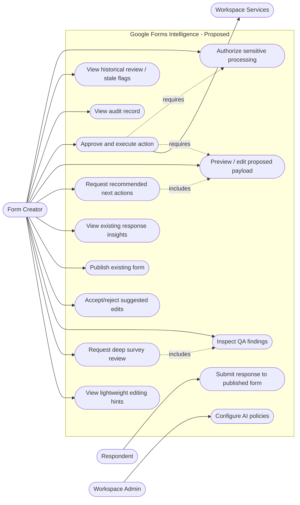
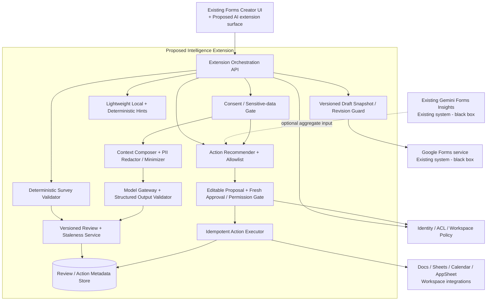
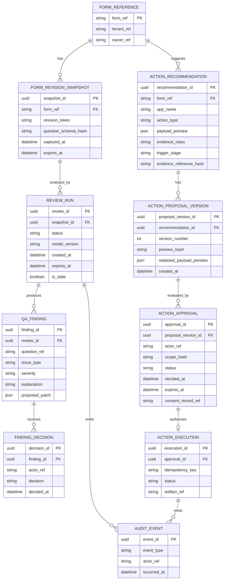
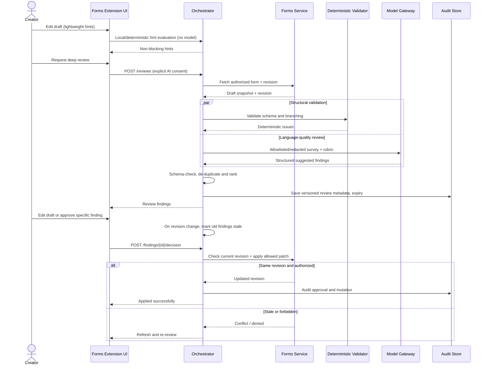
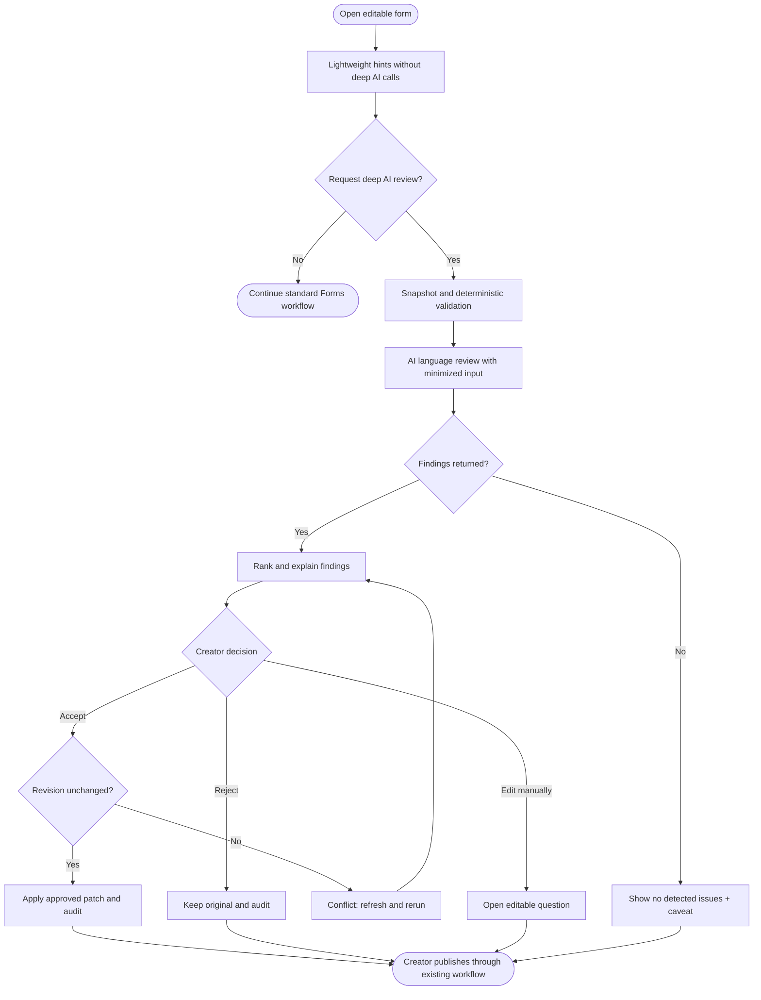
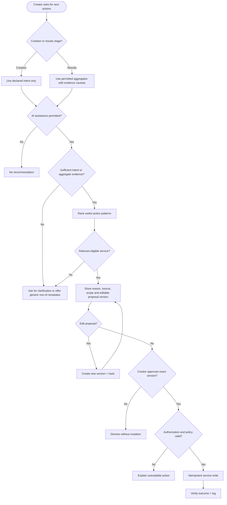
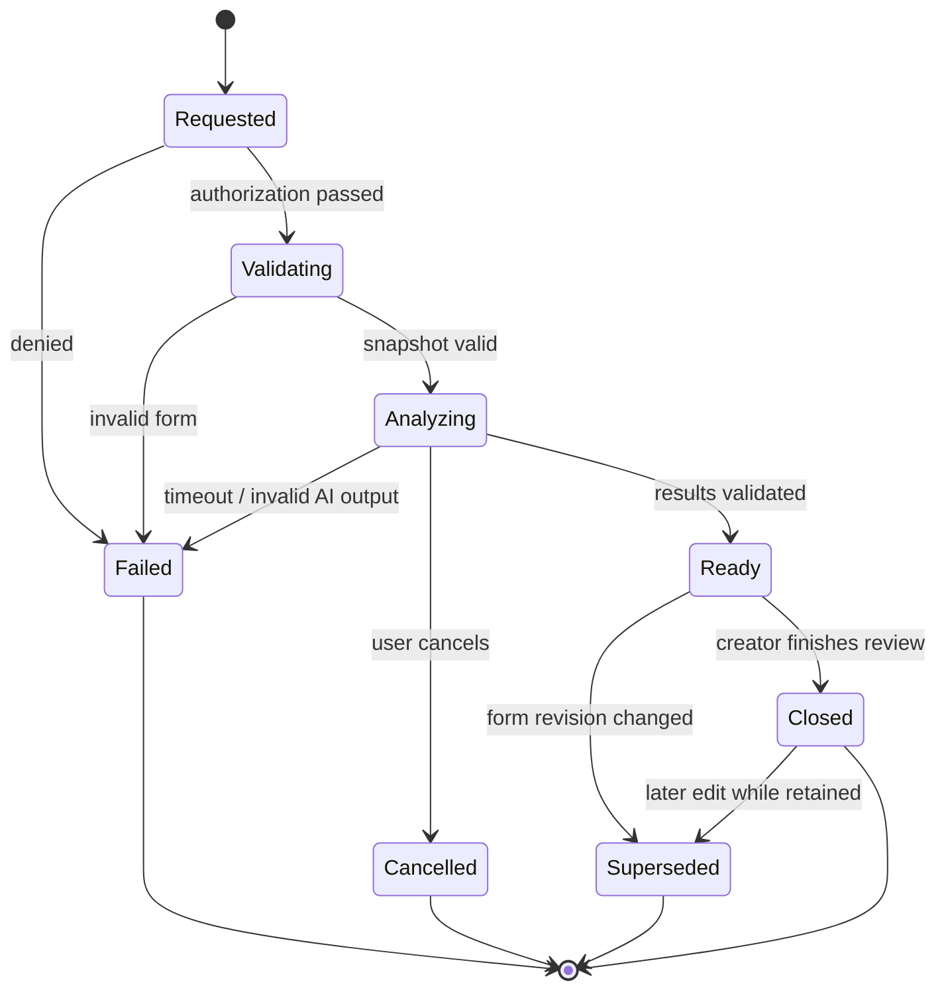
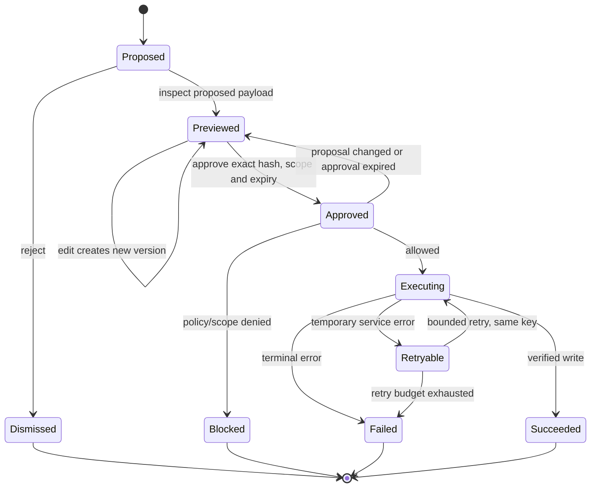
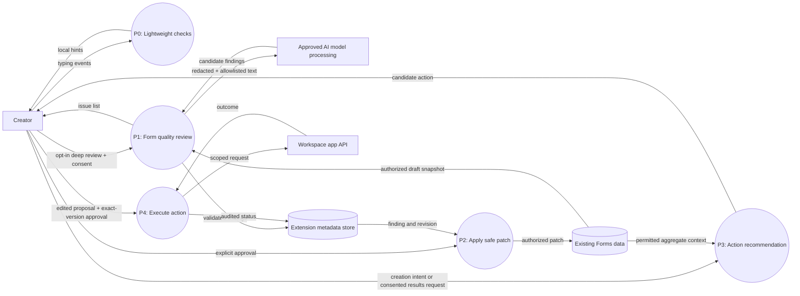

# Google Forms Intelligence
## Unified Product Requirements & Software Design Specification — v3.0
**Date:** 20 November 2026  
**Status:** Proposed concept; independent portfolio case study  
**Product context:** Hypothetical first-party Google Forms integrated extension  
**Intended audience:** Product managers, software engineers, UX researchers, security reviewers

> **Integrity note.** This is an independently proposed design, not a Google-endorsed feature or a representation of Google's private architecture. All API shapes, database entities, service boundaries and performance targets below are **proposed contracts**, not existing Google APIs. Existing Google Forms/Gemini features are distinguished from proposed work. Research findings are directional secondary evidence, not a representative user survey.


## Project phases — single source of truth

This file is the **only canonical Markdown specification**. New research, decisions, diagrams, implementation outcomes and validation results must be incorporated here, rather than created as separate phase Markdown files.

| Phase | Scope | Status as of 20 Nov 2026 | Exit criteria |
|---|---|---|---|
| 1. Landscape and voice of customer | Google Forms, Gemini, competitors, secondary reviews | Desk research drafted | Source register and evidence limitations documented |
| 2. Product strategy | Vision, persona, MVP scope, value proposition, prioritization, metrics | **Direction confirmed** | MVP and rejected alternatives explicit |
| 3. Requirements and system design | Use case, component, ER, sequence, activity, state, DFD, API and traceability | **Design decisions finalized; implementation unverified** | Five Phase 3 decisions, diagrams, contracts and traceability reconciled |
| 4. Prototype and testing | Clickable creator-to-action workflow, synthetic fixtures and 2–3 usability sessions | Not started | Results recorded separately from hypotheses |
| 5. Application submission | Portfolio presentation, README, resume link and source appendix | Not started | Honest independent-case-study disclaimer, working links |

**Phase 3 decisions (confirmed 20 Nov 2026):** Q1 hybrid lightweight editing checks plus opt-in deep review; Q2 recommendations during creation (intent) and after collection (evidence); Q3 AI prepares, creator previews/edits/approves; Q4 versioned review history with staleness marking; Q5 privacy-first minimization, best-effort identifier redaction, and explicit authorization for sensitive workflows.

**Decision log (approved):** retain Google Forms simplicity; offer creator-initiated AI Survey Quality Copilot + creator-approved Sheets/Docs actions as MVP; defer saved evidence-linked insights, longitudinal research and autonomous multi-step agents. Dedicated Product Research Mode is **removed** from the proposed design. Explore purpose-built templates for different survey workflows only as a research backlog item.

## 1. Executive product brief

### 1.1 Product problem
Google Forms reduces the effort of collecting feedback. For creators making consequential decisions, however, collecting answers is only one step: they need to avoid confusing or biased questions, understand the limitations of collected data, and translate survey findings into appropriate follow-up work. Current Gemini functionality already assists with form creation and actionable response insights; this proposal does **not** duplicate those features. It explores two adjacent user needs: (a) **pre-publication quality assurance** with actionable explanations, and (b) **contextual, creator-approved Workspace next actions**. Whether these needs justify investment remains a hypothesis pending primary validation.

### 1.2 Product vision
**Design with confidence → Collect with clarity → Understand with evidence → Act with control.** Preserve the core Forms experience; surface assistance only at moments of genuine need.

### 1.3 Primary users and jobs to be done
| Persona | Job to be done | Critical concern |
|---|---|---|
| Research-oriented creator (PM, UX researcher, operations lead) | Publish a survey whose questions support an intended decision | Measurement validity and respondent burden |
| Small-team creator | Translate feedback into manageable follow-up work | Time, permissions, integration complexity |
| Survey respondent | Answer clearly and privately | No hidden manipulation or extra collection |
| Workspace administrator | Control AI and external service access | Consent, retention, auditability |

### 1.4 Outcomes, not features
1. Lower the number of severe question-quality problems remaining at publication.
2. Reduce creator time spent manually turning findings into the first approved follow-up artifact.
3. Preserve creator trust through explainability, opt-in integrations and accurate capability boundaries.

## 2. Assumptions and evidence boundary

| Statement | Classification | Validation plan |
|---|---|---|
| Forms API supports form CRUD-like operations, response retrieval, watches | Verified public documentation | Developer docs [S1][S2] |
| AppSheet can trigger automations from Forms submissions | Verified public documentation | AppSheet help [S3] |
| Gemini provides actionable response insights in Forms in Nov 2026 | Verified public announcement | Workspace update [S4] |
| Many creators publish leading or ambiguous questions | Hypothesis / anecdotal signal | Usability audit + 5 short creator interviews |
| Creators want service suggestions within Forms | Unvalidated hypothesis | Concept test; measure rejection reasons |
| Better review reduces invalid responses | Hypothesis | Controlled benchmark and longitudinal study |
| Review findings can be directly attached to production Forms UI | Hypothetical internal integration | Not accessible from an external prototype |

### 2.1 Alternatives considered
| Strategy | Benefit | Risk | Decision |
|---|---|---|---|
| Build a new standalone survey product | High design freedom | Duplicate Google Forms, weak strategic fit | Reject |
| Add only AI-generated questions | Easy demo | Overlaps existing Gemini functions | Reject |
| Add survey QA plus approved contextual actions | Addresses before/after workflow | Relevance/consent complexity | **Selected MVP** |
| Build autonomous multi-app research agent | Broad value | Trust, data leakage, cost, failure modes | Defer |

## 3. Product scope and functional requirements

### 3.1 MVP requirements
| ID | Requirement | Priority | Acceptance criterion |
|---|---|---|---|
| FR-01 | Hybrid review: lightweight local/deterministic hints while editing, deep AI review on creator request | Must | Typing does not trigger deep model calls; creator can cancel deep review |
| FR-02 | Detect leading, double-barreled, ambiguous questions and missing response options | Must | Findings identify question ID, issue category, explanation, severity and suggested edit |
| FR-03 | Validate structural constraints deterministically | Must | Branch targets and referenced question IDs checked without relying on LLM alone |
| FR-04 | Present per-finding accept/reject/edit | Must | No change written without explicit creator decision |
| FR-05 | Protect against stale or conflicting updates | Must | Patch checks form revision; mismatch returns conflict and requires re-review |
| FR-06 | Keep versioned review metadata and decisions, avoiding raw responses in logs | Must | Reviews tie to revision tokens; editing marks older findings stale; scoped retention applies |
| FR-07 | Recommend Workspace next-actions during creation (declared intent) and after results (authorized, supported evidence) | Must | Stage and evidence provenance are distinguished; each proposal has reason, destination, editable payload preview, data scope and permissions |
| FR-08 | Prepare, preview, edit, then explicitly approve each Workspace action | Must | Edited preview invalidates old approval; no external mutation before fresh approval |
| FR-09 | Verify access/scope and handle unavailable integrations | Must | Denied/missing permission yields transparent fallback; no hidden grant |
| FR-10 | Allow dismiss, disable and feedback on recommendations | Must | Dismissed suggestions do not auto-execute or repeatedly reappear in the same context |
| FR-11 | Show relevant optional recommendations at both creation and results stages | Must | Creation uses stated intent only; post-response uses authorized aggregate findings only; no forced promotional placement |
| FR-12 | Explain uncertainty/insufficient evidence for insight-based actions | Must | Low sample size/weak support suppresses strong causal recommendations |
| FR-13 | Allow download of decision log | Could | Creator exports approved actions and rationale |
| FR-14 | Redact identifiers where feasible and use least-data AI context | Must | Redaction check and field-level allowlist precede model processing; unsafe inputs blocked |
| FR-15 | Gate sensitive workflows on explicit, purpose-specific authorization | Must | No sensitive context or destination action transmitted without valid scoped consent and policy clearance |
| FR-16 | Version reviews and mark findings stale after draft changes | Must | All earlier review runs remain available within retention; stale suggestions cannot be applied |
| FR-17 | Persist editable action proposal versions, approval binding and expiry | Must | Payload change creates new version/hash and requires renewed approval |

### 3.2 Later roadmap, explicitly not MVP
| ID | Roadmap capability | Important constraint |
|---|---|---|
| RM-01 | Evidence-linked saved insight snapshots | Must respect response privacy and source permissions |
| RM-02 | Longitudinal surveys and cohort comparisons | Require compatible questions and representative samples |
| RM-03 | Research decision register | Avoid implying AI recommendations are proven causal findings |
| RM-04 | Multi-step approved orchestration | Per-step scope and authorization, rollback/compensation |

### 3.3 Non-functional requirements (proposed initial targets)
| ID | Category | Proposed requirement / target |
|---|---|---|
| NFR-01 | Privacy | Minimize personally identifying response fields; redact by default before model processing |
| NFR-02 | Access | Respect form ownership, editor ACL, Workspace policies, OAuth least privilege |
| NFR-03 | Security | Encrypt at rest/in transit; immutable action audit; enforce authorization server-side |
| NFR-04 | Reliability | Duplicate execution requests do not create duplicate artifacts (idempotency) |
| NFR-05 | Latency | Aim for p95 under 15 seconds for review of up to 30 questions; benchmark, not a promise |
| NFR-06 | Explainability | Every finding contains rule/evidence and non-authoritative AI explanation |
| NFR-07 | Accessibility | Keyboard access, screen-reader labels and WCAG 2.2 AA design target |
| NFR-08 | Cost | Bound model tokens, cap retries and expose fallback on budget exhaustion |
| NFR-09 | Retention | Configurable expiry for versioned snapshots and logs; delete or de-identify on source removal and creator request, subject to legal/admin policies |
| NFR-10 | Observability | Pseudonymous telemetry; never log raw survey answers or OAuth tokens |


## 3A. Future exploration — task-specific templates (not MVP)

**Idea parked for research, not approved for implementation:** Investigate whether purpose-built template packs make Google Forms more useful for recurring workflows, without introducing a separate AI mode or specialized product interface. Examples include product feedback and feature discovery, course administration and learning feedback, employee onboarding and small-business intake.

**Potential experience:** A creator starts from a structured template with an example question set, optional branching recommendations and relevant Workspace follow-up suggestions. The standard survey quality review and creator-approval safeguards still apply. Template content must be editable and clearly presented as a starting point rather than validated research methodology.

**Decision gate:** Research template demand, workflow recurrence and existing Google Forms templates before prioritization. No new dedicated entities, APIs, modes or prototype flows are approved for this concept.

## 4. UML use-case model

### 4.1 Use-case diagram

**Notation:** This is a use-case-oriented flowchart rather than strict UML oval/actor syntax, chosen for cross-platform Mermaid rendering. Respondent arrow represents responding to a published form, not publishing it.

### 4.2 Primary use-case specifications
| UC | Preconditions | Main success path | Alternatives / exceptions | Postcondition |
|---|---|---|---|---|
| UC-01 Review draft | Creator has edit access, draft exists | Lightweight local hints during editing; on request snapshot revision → deterministic checks + redacted AI language review → versioned findings | Timeout, stale version, policy denial, cancel | Form unchanged; reviews versioned and superseded reviews identified |
| UC-02 Apply correction | Review finding references current revision | Preview diff → creator approves → validate patch → conditional write → audit | Revision conflict, forbidden patch, user rejects | Only selected approved edit applied |
| UC-03 Recommend action | Creator opted in; either stated goal at creation or eligible aggregate evidence after collection | Tag stage and provenance → rank permitted Sheets/Docs action → show editable proposal and disclosure | Weak evidence, unsafe data, policy blocks, no relevant app | Recommendation shown or suppressed; no action yet |
| UC-04 Execute approved action | Creator previews and edits proposal, approves exact version/hash and authorized scope | Check fresh approval, ACL/policy/scope → idempotent write → verify result → audit | Edited-after-approval, expired consent, OAuth denied, timeout | One artifact or clear failure/pending reconciliation; never silent duplicate |
| UC-05 Configure controls | Admin authorized | Set allowed actions, retention and AI enablement | Unsupported policy | Policy enforced at serving time |

## 5. Architecture & component model

### 5.1 Component diagram

**Trust boundaries:** Forms and existing Gemini insights are black boxes; no assumption that an external developer can invoke their internal implementation. Model Gateway is hypothetical. Workspace integrations require product-specific APIs/scopes and policy verification.

### 5.2 Implementation paths
| Dimension | Hypothetical integrated Google product | Public-API proof of concept |
|---|---|---|
| Editor placement | Native Forms editor surface | Separate companion web UI |
| Form read/update | Internal authorized service | Documented Forms API where supported [S1][S2] |
| Response analysis | Existing integrated Gemini insights | Own aggregate analysis from authorized responses; never claim parity |
| Workspace actions | Internal integrations | OAuth + publicly documented service APIs, if permissions available |
| Deployment | Google-controlled infrastructure | Prototype environment only |

## 6. Data model (proposed extension-owned entities)


**Data ownership:** Form responses remain in the authoritative Forms system. Extension storage contains metadata, hashes, selected previews and approved records; do not replicate raw responses by default. Entity keys are conceptual, not Google IDs.

## 7. Dynamic behavior / sequences

### 7.1 Sequence: survey quality review and patch


### 7.2 Sequence: contextual Workspace action
```mermaid
sequenceDiagram
  actor C as Creator
  participant UI as Forms Extension UI
  participant R as Recommender
  participant P as Policy / Auth
  participant X as Action Executor
  participant W as Workspace Service
  participant A as Audit Store
  C->>UI: Ask for next actions (creation or results)
  UI->>R: Creation: declared intent; Results: authorized aggregates
  R->>R: Relevance filter + allowlisted action templates
  R-->>UI: Rationale, destination, data preview, confidence caveat
  C->>UI: Review and optionally edit proposal
  UI->>R: Recalculate proposal version and hash if edited
  R-->>UI: Updated preview
  C->>UI: Approve exact version and permitted data scope
  UI->>P: Validate approval hash, expiry, privacy consent, identity and policy
  alt Approved and authorized
    P-->>UI: Permission granted
    UI->>X: Execute with idempotency key
    X->>W: Scoped write (e.g., draft document)
    W-->>X: Artifact ID / error
    X->>A: Record outcome
    X-->>UI: Artifact link or specific error
  else Denied or unavailable
    P-->>UI: Block + reason
  end
```

## 8. Activity diagrams

### 8.1 Creator journey


### 8.2 Action recommendation decision policy


## 9. State machines

### 9.1 Review run


### 9.2 Cross-app action


## 10. Data flow diagram (logical, not network topology)


**Privacy boundary:** Public response content and individual respondent identifiers must not enter the recommendation engine by default; use approved aggregates and minimum necessary input.

## 11. API contracts (proposed internal extension API, not Google API)

### 11.1 Endpoints
| Method | Endpoint | Purpose | Key responses |
|---|---|---|---|
| POST | `/v1/forms/{formRef}/reviews` | Explicit deep review of known revision, with scoped AI consent | `202 reviewId`, `403`, `409`, `429` |
| POST | `/v1/forms/{formRef}/hints` | Lightweight deterministic, no-model hints (optional server-side fallback) | `200`, `403` |
| GET | `/v1/forms/{formRef}/reviews` | List versioned reviews and staleness, bounded by retention | `200`, `403` |
| GET | `/v1/reviews/{reviewId}` | Read status and findings | `200`, `403`, `404` |
| POST | `/v1/findings/{findingId}/decisions` | Accept, reject or modify | `200`, `403`, `409`, `422` |
| POST | `/v1/forms/{formRef}/action-recommendations` | Produce opt-in suggested actions | `200`, `403`, `422`, `429` |
| PATCH | `/v1/recommendations/{id}/proposal` | Create edited preview version and new hash | `200`, `403`, `409`, `422` |
| POST | `/v1/recommendations/{id}/approve` | Approve exact proposal version, scope, expiry and consent | `200`, `403`, `409` |
| POST | `/v1/approvals/{id}/execute` | Initiate idempotent write | `202`, `403`, `409`, `502` |
| GET | `/v1/executions/{id}` | Read verified outcome | `200`, `403`, `404` |

### 11.2 Example request/response
```json
POST /v1/forms/form_123/reviews
{
  "revisionToken": "rev_17",
  "checks": ["bias", "ambiguity", "double_barreled", "branch_integrity"],
  "consent": {"aiProcessing": true, "purpose": "question_quality_review"}
}

202 Accepted
{
  "reviewId": "r_001",
  "status": "validating",
  "formRevision": "rev_17"
}
```
```json
GET /v1/reviews/r_001
{
  "status": "ready",
  "findings": [{
    "findingId": "f_001",
    "questionRef": "q_7",
    "issueType": "leading_question",
    "severity": "medium",
    "explanation": "The wording presupposes satisfaction.",
    "suggestedText": "How satisfied are you with the service?",
    "evidenceKind": "linguistic_heuristic",
    "requiresCreatorApproval": true,
    "isStale": false,
    "snapshotRevision": "rev_17"
  }]
}
```
```json
POST /v1/recommendations/a_001/approve
{
  "proposalVersionId": "pv_002",
  "previewHash": "sha256:example",
  "consentRecordRef": "consent_01",
  "approvedScope": ["docs.documents.create"],
  "approvedPayload": {"title": "Research follow-up draft"}
}
```
**Q2 provenance contract:** `triggerStage` is `creation` or `results`. Creation-time suggestions must not cite uncollected results; results-time suggestions require permitted aggregates, minimum evidence checks and provenance metadata. **Q4 history:** updating a form marks retained older review runs stale; stale findings cannot patch newer revisions. **Q5 privacy:** model requests use field allowlists, best-effort redaction and sensitive-workflow consent; redaction is not guaranteed to remove every identifier, so policy blocks or local-only fallback are mandatory for unsafe inputs.

**Contract safeguards:** Server revalidates owner/editor permissions, schema and exact preview hash; client consent flags alone never grant authorization. `Idempotency-Key` header is required for execution; retry with the same key and payload returns the original execution. An approval expires after a bounded interval.

## 12. AI design & responsible-use specification

### 12.1 Hybrid evaluation
- **Q1 trigger policy:** lightweight deterministic checks execute on editing events; deep language-model review only on explicit creator request. Do not dispatch model calls per keystroke.
- **Deterministic checks:** invalid branch targets; missing required destinations; duplicate IDs; unsupported edits; stale revision; applicable structural constraints.
- **AI language checks:** loaded/leading wording, compound questions, unclear terms, unbalanced options, potentially excessive cognitive burden. These are *suggestions*, not definitive scientific diagnoses.
- **Schema validation:** reject malformed output, unrecognized question refs, contradictory patches, unsupported destinations or fabricated evidence.
- **Recommendation policy:** map user goals to allowlisted action templates, then rank by utility and permissions—not by promotional priority.

### 12.2 Trust and abuse cases
| Risk | Control | Fallback |
|---|---|---|
| Hallucinated QA issue | Show exact text and rationale; allow rejection | Keep original |
| Prompt injection through survey question / response | Treat survey content as untrusted data, never instructions | Ignore injected command |
| Recommending a Google app without real task relevance | Minimum utility threshold; explain why; neutral alternatives | Show no recommendation |
| Inferring causal relationship from correlated responses | Avoid causal phrasing absent stronger evidence | State observational limitation |
| Exposure of respondent personal data | Data minimization, aggregation, permissions, retention | Suppress action |
| Unapproved cross-app write | Scoped preview hash + explicit click + server auth | No mutation |
| Duplicate requests on retries | Idempotency key + execution state | Return prior outcome |
| Model unavailability | Deterministic checks still available | Transparent degraded mode |
| Organization disables AI | Policy gate before processing | Standard Forms workflow |

## 13. Requirements traceability and tests

| Requirement | Use case | Component(s) | Verification scenario | Metric |
|---|---|---|---|---|
| FR-01, FR-02 | UC-01 | Hints, Snapshot, AI, Validator | Typing triggers local hints; manual deep QA identifies leading question | Issue detection precision; unsolicited model calls = 0 |
| FR-03 | UC-01 | Deterministic Validator | Invalid branch target flagged | Structural detection recall |
| FR-04, FR-05 | UC-02 | Decision, Revision Guard | Accept edit after concurrent change | Unauthorized edits = 0 |
| FR-06, FR-16 | UC-01, UC-02 | Versioned Review Store, Revision Guard | Edit after review; old findings become stale and inapplicable | Stale patch executions = 0 |
| FR-07, FR-11 | UC-03 | Recommender | Separate creation-intent and result-evidence fixtures | Provenance correctness |
| FR-08, FR-09, FR-17 | UC-04 | Proposal Version, Approval, Auth, Executor | Edit after approval; expired/mismatched hash must block | Unauthorized writes = 0 |
| FR-10 | UC-03 | Recommender | Dismiss recommendation | Dismissal/repeat complaint rate |
| FR-12 | UC-03 | Recommender | 3 inconsistent responses only | Overconfident recommendations = 0 in test set |
| NFR-04 | UC-04 | Executor | Retry request twice | Duplicate artifacts = 0 |
| FR-14, FR-15, NFR-01, NFR-10 | All | Minimizer, Redactor, Consent, Telemetry | Add names, emails and sensitive text; deny scope | No unauthorized AI request or external data transfer in test suite |

### 13.1 Suggested benchmark data set
Construct 20 synthetic surveys with approximately 200 questions total, containing labeled leading/double-barreled/ambiguous and valid examples. Use a separate 30-question structural branching fixture. Build 12 contextual action scenarios: 6 relevant, 3 ambiguous and 3 intentionally unsuitable. Have at least two human reviewers annotate disagreements. Do not fabricate actual results.

### 13.2 Experiment plan
| Design | Primary measure | Guardrails |
|---|---|---|
| A/B creator study: existing workflow vs QA review | Severe issue count in final published questionnaire, scored blind by reviewers | Time to publish; creator correction burden; false positives |
| Concept test: contextual actions vs no suggestions | Proportion of creators completing a *useful, approved* follow-up within session | Distrust, irrelevant suggestion rate, consent withdrawals |
| Technical safety tests | Authorization and duplicate-execution incidents | Sensitive data exposure, model spend, latency |

**North-star candidate:** Share of creator sessions that reach a verified, user-approved next step **without introducing questionnaire quality regressions**. Do not optimize solely for Workspace adoption, which could reward intrusive recommendations.

## 14. Release and prioritization

| Phase | Investment | Launch gate |
|---|---|---|
| 0: Research/design | Concept audit; small creator interviews; labeled test fixtures | Recurring, decision-relevant pain confirmed |
| 1: MVP alpha | Lightweight local hints + creator-triggered deep QA; versioned findings | Structural validation works; stale findings blocked; no unsolicited model calls |
| 2: Limited action pilot | Opt-in Docs/Sheets templates with approval | Useful recommendations exceed distracting ones |
| 3: Roadmap consideration | Saved evidence-linked insight history and additional apps | Privacy, cross-survey coherence and ROI justified |

**Build-versus-not-build trigger:** If creators do not experience meaningful errors or value the existing simplicity above added review friction, do not ship QA by default; retain a voluntary advanced mode or stop investment. If action suggestions are mostly rejected as irrelevant, do not expand cross-app recommendations.

## 15. Open decisions and dependencies

| ID | Decision needed | Owner role | Proposed resolution |
|---|---|---|---|
| D-01 | Is QA on-demand or auto-run? | PM / UX | **Closed Q1:** Hybrid local checks and manual deep review |
| D-02 | Which application first for action pilot? | PM / Eng | Docs draft or Sheets analysis template; both opt-in |
| D-03 | What constitutes sufficient survey evidence? | Research / ML | Explicit thresholds per action type; do not universalize 12-response rule |
| D-04 | Where are review metadata stored? | Privacy / Eng | **Closed Q4:** Versioned, time-bounded extension store with stale flags |
| D-05 | Which Workspace enterprise policies apply? | Admin / Security | Verify before enablement |
| D-06 | Does user testing justify expansion beyond first two actions? | PM | Gate on research data |

## 15A. Phase 3 architecture decision record (confirmed)

| Decision | Choice | Design implication | Test gate |
|---|---|---|---|
| ADR-07 / Q1 | Hybrid checks | Editing = lightweight deterministic hints; explicit deep AI request | No deep model requests triggered by typing |
| ADR-08 / Q2 | Both stages | `triggerStage` and provenance separate creator intent from results evidence | No fabricated response-based recommendation during creation |
| ADR-09 / Q3 | Prepare, preview, edit, approve | Immutable proposal versions and short-lived, scoped approval | Changed preview or expired approval cannot execute |
| ADR-10 / Q4 | Versioned reviews | Revision-linked review history; earlier findings flagged stale | No stale patch can modify a changed form |
| ADR-11 / Q5 | Privacy-first hybrid | Least-data context, identifier redaction, explicit sensitive authorization | Unsafe context blocked before model/integration calls |

**Consistency review result:** use-case diagram, component graph, ER entities, both sequence diagrams, both activity diagrams, both state machines, logical DFD, APIs, tests and traceability now reflect Q1–Q5. This is a design-level consistency reconciliation, not verification against an implementation. Open production dependencies remain: actual Google internal contracts, consent governance, retention policy, Google Workspace app permissions and human evaluation of suggestion quality.

## 16. Source register and citation notes

| ID | Source | Supports | URL |
|---|---|---|---|
| S1 | Google for Developers — Forms API Overview | Create/update forms, retrieve responses, watch notifications | https://developers.google.com/workspace/forms/api/guides |
| S2 | Google for Developers — Forms REST API Reference | Public resource/method boundaries | https://developers.google.com/workspace/forms/api/reference/rest |
| S3 | Google Help — AppSheet automation from Forms | Existing Forms-triggered automation | https://support.google.com/appsheet/answer/14634161?hl=en |
| S4 | Google Workspace Updates — Actionable Insights (5 Nov 2026) | Existing Gemini response insights and next-step suggestions | https://workspaceupdates.googleblog.com/2026/11/get-actionable-insights-with-gemini-in-Google-Forms.html |
| S5 | Google for Developers — Forms API Usage Limits | API quotas and 429 error conditions | https://developers.google.com/workspace/forms/api/limits |
| S6 | Google Workspace Updates — Quantitative text insights | Existing Gemini text-response analysis | https://workspaceupdates.googleblog.com/2026/02/get-quantitative-insights-from-text-responses-with-gemini-in-forms.html |
| S7 | Capterra — Google Forms user reviews | Directional consumer-review signals; not representative | https://www.capterra.com/p/176571/Google-Forms/reviews/ |
| S8 | TrustRadius — Google Forms reviews | Directional functionality reviews | https://www.trustradius.com/products/google-forms/reviews |
| S9 | G2 — SurveyMonkey vs Google Forms | Comparative evaluation, vendor/editorial context | https://learn.g2.com/surveymonkey-vs-google-forms |
| S10 | Reddit — Survey tools for PM research | Anecdotal workflow preferences | https://www.reddit.com/r/ProductManagement/comments/1h2gzbu/do_you_use_surveyform_tools_to_get_user_insights/ |
| S11 | Reddit — Survey recommendations | Anecdotal visual customization/embedding preferences | https://www.reddit.com/r/ProductManagement/comments/1b0w78f/survey_tool_recommendation/ |
| S12 | SurveyMonkey — AI Survey Generator | Existing AI survey generation and bias/structure assistance | https://www.surveymonkey.com/product/features/ai-survey-generator/ |
| S13 | Dovetail — Product Research | Existing source-traceable AI research synthesis | https://dovetail.com/solutions/product-research/ |

**Research quality statement:** The linked reviews are secondary, self-selected accounts. Neither review count nor average rating estimates the prevalence of a particular problem. Review dates may predate Gemini's November 2026 launch. All proposed performance metrics and API payloads in this document are hypotheses or designed specifications, not measured Google production outcomes.

## 17. Document control

| Field | Value |
|---|---|
| Version | 3.0 |
| Status | Phase 3 design reconciled; prototype and real-world validation pending |
| Owner | Independent applicant / portfolio author |
| Architecture | Hypothetical first-party Forms integrated extension |
| MVP | Hybrid QA and context-aware, editable, creator-approved Sheets/Docs actions |
| Explicit non-MVP | Evidence-linked history; autonomous workflow agent; full Forms redesign |
| Documentation policy | One canonical `SPECIFICATION.md` across all project phases |


## Appendix A — Phase 2 approved prioritization and research plan

The product strategy decisions below are merged from the previous `PHASE_2_PRODUCT_STRATEGY.md`; this master file supersedes that separate document.

**Primary persona:** Research-oriented PM / UX researcher in a small team. **Secondary:** small business creator. **Non-target:** specialist enterprise panel researchers. This persona is a user segment, not a specialized product mode.

**Strategic scoring rubric:** perceived user value 35%, recurrence 20%, feasibility 25%, risk/manageability 20% (1–5, higher is better). These numbers are illustrative judgments, not measured evidence.

| ID | Workspace workflow | Score | Decision |
|---|---|---:|---|
| WR-01 | Sheets feedback tracker | 4.80 | P0 MVP |
| WR-02 | Docs research/action memo | 4.60 | P0 MVP |
| WR-06 | Docs training-needs summary | 3.70 | P1 |
| WR-03 | Calendar interview preparation | 3.55 | P1 |
| WR-05 | Looker Studio trend dashboard | 3.55 | P1 |
| WR-08 | Slides executive summary | 3.45 | P1 |
| WR-04 | AppSheet issue automation | 3.25 | P2 |
| WR-07 | Gmail follow-up drafts | 3.15 | P2 |

**Research gates:** validate actual creator difficulties, assess whether the existing Gemini experience already solves the issue, test objective-to-question alignment on labeled examples, evaluate relevance of Workspace proposals, and assess approval friction.

**Decision records:**
- DR-01: Default Forms flow remains simple; survey QA and Workspace actions are optional.
- DR-02: MVP consists of survey QA and previewable, approved Sheets/Docs recommendations.
- DR-03: Intent-based creation suggestions and evidence-based post-response suggestions are not interchangeable.
- DR-04: A no-recommendation result is valid; do not maximize Google service promotion.
- DR-05: No autonomous email/scheduling/permissions or fake insights.
- DR-06: Do not introduce a dedicated Product Research Mode. Investigate customizable templates for recurring workflows (product feedback, course administration and others) as a separate future opportunity.

## Appendix B — Phase 4 test record template (pending)

| Study / date | Participants | Scenario | Baseline | Prototype outcome | Observed errors | Decision |
|---|---:|---|---|---|---|---|
| Not yet conducted | — | Onboarding research | — | — | — | Do not claim validation |

## Appendix C — Phase 5 application readiness (pending)

- [ ] Verify all research source dates and evidence notes.
- [x] Review/reconcile diagrams and contracts against five selected design decisions (implementation unverified).
- [ ] Build one connected prototype; mark all data as synthetic.
- [ ] Record actual usability observations, without invented metrics.
- [ ] Add artifact/prototype links and independent-project disclaimer to the case study.
- [ ] Confirm application attachment/link constraints and submission eligibility.
